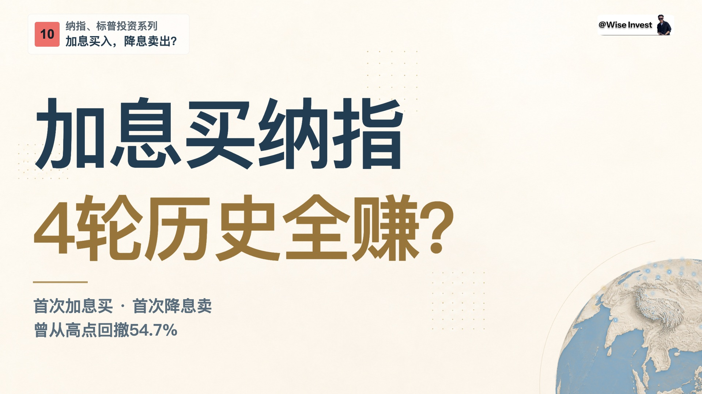

# 第10期 · 三比例封面实际参考

用户最新明确指定《纳斯达克投资》第10期的左上栏目、右上署名、封面与最终结尾作为满意的整体视觉基准。本目录保存该期最终三张 JPEG 的**原字节副本**，不是新封面，也没有重渲染、重压缩、改字或替换字体。

| 比例 | 实际参考 | 原尺寸 |
| --- | --- | --- |
| 16:9 | [横版](ep10-cover-16x9.jpg) | 1920×1080 |
| 3:4 | [竖版](ep10-cover-3x4.jpg) | 1200×1600 |
| 4:3 | [四比三](ep10-cover-4x3.jpg) | 1600×1200 |

## 如何用于下一期

先看实际图，再用 [EP09 顶部布局模板](../ep09-header-three-ratios/README.md) 和本期文稿实现。**EP09 是可编辑模板与顶部布局的来源，EP10 是当前整体视觉完成度的对照。** 二者兼容，不重命名历史模板来源，也不把 JPEG 当可编辑模板或直接裁成其他比例。

- 左上：暖白底紧凑栏目块，红底深色期数，两行文字左对齐且分级；右上：原白底头像署名。三个比例都保持这一左右关系。
- 大字内容区：主标题第一焦点，左对齐、硬朗黑体；深蓝第一句、哑金重点问句，短金线与较小的条件／风险文字在下方。不是卡片堆叠，也不把署名做成主标题。
- 留白与地球：米白背景、右下小地球作为辅助，地球不盖住主题文字；加入产品截图时调整截图自身，使其不遮住地球。正文视频另按全画布构图，不能将封面的右下地球约束误用为视频正文必须空出右栏。
- 三比例各自排版：16:9 与4:3的主题为两行；3:4将金色问句分成两行，整体三行大字，并在底部保留历史样本提示。不可从横图直接裁竖图。实际新文案需要重新分行和检查。
- 封面栏目在这三张历史图里是“纳指、标普投资系列”；[EP10 正文顶栏参考](../../../wise-video/assets/series-chrome/README.md) 为“纳斯达克投资 · 第10期”。这是两种交付的实际参考，不要为了统一名称回改已确认图片；新期用明确栏目名与新期数。

图中“4轮”“54.7%”和加／降息话题是第10期内容，不是可继承的新一期结论。新文案保留本期真实条件与否定，不把历史样本写成未来收益保证。字体不随本目录分发；新机使用合法中文字体，重新检查字形和宽度。

[完整布局规则](../../references/wise-series-layout.md) 定义实现要求；[EP10 片尾参考](../../../wise-video/assets/signature-outro/README.md) 提供真实头像、话题、订阅、金色收藏和告别的对应结构。最终是否达到基准需看每张全图与320px等比缩略图；参考图的既有批准不等于新图自动通过。

来源文件名、尺寸与 SHA256 见 [manifest](manifest.json)。不含字体、完整视频、旁白或私人工程；未改动现有默认HTML模板。
