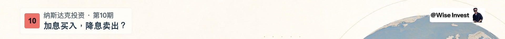

# 纳斯达克投资系列常驻顶栏

可携带的 EP10 系列顶栏：左上珊瑚红底深色期数＋两行栏目文案，右上原白底 10% 圆角署名。覆盖开场、正文、章节与收尾。`source-ep10-header.jpg` 是已批准成片第 327.5 秒的顶部裁片；`reference-rendered.jpg` 是本包真实浏览器渲染。历史文档的“白字期数”已按原成片及用户红底黑字决定纠正。



## 运行与接入

保留整个 `wise-video/assets` 相对结构。从 Skill 根目录运行 `python3 -m http.server 8790 --bind 127.0.0.1`，打开 `/assets/series-chrome/index.html?t=4`。无网络依赖、无需 npm/GSAP；浏览器需支持 WebGL。默认 1920×1080，30fps，字体使用系统中文字体回退，不分发字体文件。

`index.html` 是完整背景＋顶栏最小例子。`chrome-fragment.html` 与 `series-chrome.css` 是可嵌入部件。只需调用：

```js
setSeriesChrome({episode: 11, topic: '汇率如何影响收益？'});
renderAt(4); // 秒；可任意顺序 seek，不含播放计时器
```

真实工程应保留自己的画布与背景，仅接入一份顶栏；不要再叠加旧的左上署名。`chrome-fragment.html` 的图片 URL 按本目录为基准，移动文件时相应调整相对链接。`background-runtime.js` 沿用冻结背景绘制代码，只将 GSAP 时钟改为显式 `drawBackground(t)`，没有改写地球、山体或纹理。

浏览器录帧先等待 `document.fonts.ready`、全部图片 `decode()`，调用 `renderAt(t)` 后等两个 `requestAnimationFrame`。不要用首次未加载纹理的帧作证据。

## 几何与检查

- 左卡 `(76,30)`，高约 100；宽随主题自然变化。期数 `58×58`、`#eb7169` 底、`#172735` 深色字；第一行 24px，主题 30px。字型回退可能影响宽度，必须重新检查新文案。
- 右署名 `(1634,30)`，`210×57.37`，与左卡顶边对齐。不要把两者误解成相同高度。
- DOM 标记：`data-wise-series-chrome`、`data-persistent="true"`、`data-episode-number`、`data-series-name`、`data-episode-topic`、`data-wise-signature`。标记用于定位；仍需实测颜色、边界、透明度及矩形裁剪；绘制遮挡另看渲染帧。
- 示例没有正文，不能拿空画布证明正文表达通过；地球不是正文避让区。

来源、依赖和 SHA256 见 `manifest.json`。原视频、旁白和完整字幕不随包分发。此包只新增最小可复用源与参考图，没有修改已批准成片。
